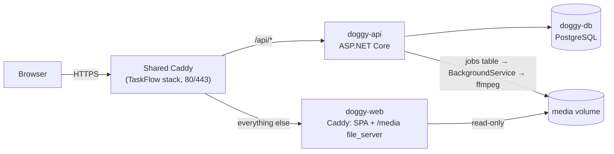

# Doggy

A self-hosted video platform built as a portfolio project: upload, server-side transcoding with ffmpeg,
a home feed, channels and subscriptions, hover previews and seek-bar thumbnails. It runs on a single
Oracle Cloud Always Free ARM server next to other apps, behind a shared Caddy reverse proxy.

> **Status: phase 0 — repository skeleton.** Only a health endpoint and a placeholder page exist.
> Nothing below is marked done until it has been run and checked; see [Status](#status).

## Stack

- **API:** ASP.NET Core Minimal API (.NET 10), EF Core, PostgreSQL, JWT, FluentValidation
- **Processing:** a Postgres job table + a .NET `BackgroundService` running ffmpeg (one job at a time, `nice`)
- **Web:** React 19 + TypeScript + Vite, dark theme first
- **Tests:** xUnit, Vitest, Playwright, plus an ffmpeg pipeline integration test
- **Delivery:** Docker Compose, GitHub Actions, Caddy

## Architecture (planned)



## Key decisions

**Shared Caddy, one file per site.** The server already runs TaskFlow with Caddy on ports 80/443.
Moving Caddy into its own stack would change who owns the ports and the certificate volume, which
risks TaskFlow downtime. Instead the existing Caddyfile gets one line, `import /etc/caddy/sites/*.caddy`,
and a host folder is mounted there as a directory. Each project writes only its own file
(`doggy.caddy`, `portfolio.caddy`) and runs `caddy validate` before reloading. Services that join the
shared `edge` network use prefixed names (`doggy-api`, `doggy-web`) so they cannot shadow TaskFlow's
`api` and `web`.

**Serving video files: Caddy `file_server` vs the API.**

| | Caddy `file_server` | Streaming through the API |
|---|---|---|
| Range requests / seeking | Built in | Built in (`enableRangeProcessing`) |
| Cost per request | Static file server; Kestrel is not involved | Every byte passes through Kestrel and middleware |
| Cache headers | ETag / Last-Modified automatically | Must be added by hand |
| Per-request access control | None (public files only) | Any rule (private, unlisted) |

Decision: public renditions, thumbnails, previews and sprites are served by `file_server` in Doggy's
own `doggy-web` container, mounted read-only on the media volume. The API never streams video bytes.
The shared Caddy is not given Doggy's volume, so TaskFlow's proxy keeps working even if Doggy is removed.
If private videos are added later, Caddy's `forward_auth` can ask the API before serving a file.

## Limits (planned, enforced server-side)

| Limit | Value |
|---|---|
| Upload size | 200 MB per file |
| Duration | 5 minutes, measured with `ffprobe` (client values are not trusted) |
| Output | 720p max (H.264 + AAC, `faststart`); the original is deleted after processing |
| Quota | 1 GB per uploader, 5 GB for the admin |
| Total media | 15 GB |
| Disk guard | Uploads close when free disk drops below 8 GB |
| Who can upload | Invite code (single use, revocable from the admin panel) |

## Status

Results come from GitHub Actions; local and server checks are added as they are run.

| Check | Result |
|---|---|
| API build + xUnit | Passed in CI (1/1 tests) |
| Web typecheck + Vitest + build | Passed in CI (2/2 tests) |
| Runs on a developer machine | Not yet checked |
| Deployed to the server | Not yet |

## Local development

Requirements: .NET 10 SDK, Node 22.12+.

```bash
dotnet test Doggy.slnx
dotnet run --project src/Doggy.Api        # http://localhost:5080/health
cd web && npm install && npm run dev      # http://localhost:5173, /api is proxied to the API
cd web && npm test
```

## Known limits

- One server, no CDN. Encoding on 2 ARM cores is slow, so processing is queued one job at a time.
- The public IP is ephemeral and the temporary address uses sslip.io, so an IP change would change the URL.
- Oracle may reclaim Always Free instances that stay idle for 7 days.
